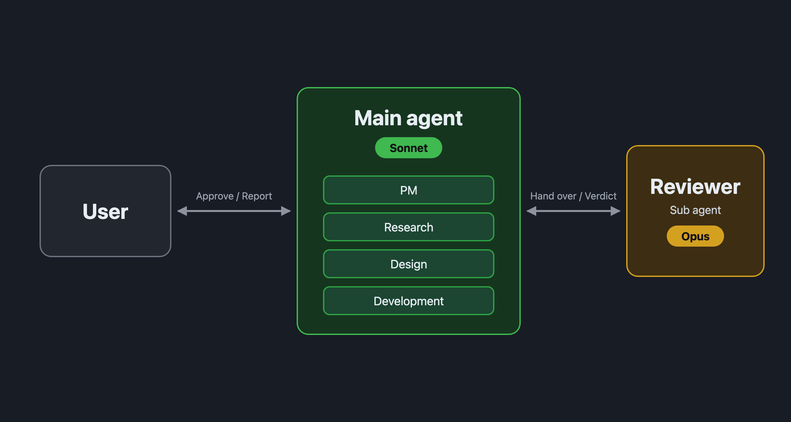

⬅️ [BACK](/blog/en/index.md)

# I Switched to a Sonnet Main Agent and Left Only Review to Opus

## Result

I switched to a setup of "a Sonnet main agent (doing PM, research, design, and development) + an Opus reviewer."

Compared with the current setup (an Opus PM + a Sonnet worker + an Opus reviewer), accuracy stayed about the same, while time and token usage dropped sharply.

| | Current | Proposal (new setup) | Difference |
| --- | --- | --- | --- |
| Small: Time | 35 min | 17 min | -53% |
| Small: Tokens | 7.71M | 4.40M | -43% |
| Small: Estimated cost | $12.10 | $5.40 | -56% |
| Small: Accuracy (out of 50) | 49 | 47 | -2 |
| Medium: Time | 55 min | 18 min | -67% |
| Medium: Tokens | 11.88M | 4.01M | -66% |
| Medium: Estimated cost | $15.00 | $5.10 | -66% |
| Medium: Accuracy (out of 50) | 42 | 47 | +5 |

On both tasks, the proposal came in far below the current setup in time, tokens, and cost. As for accuracy, the current setup scored 2 points higher on the small task, and the proposal scored 5 points higher on the medium task, so neither side won outright.

Here is the flow of my platform after the switch.

## Why It Got Faster and Cheaper

In the current setup, Opus produced about 106K–123K output tokens. In the proposal, the reviewer's share alone was about 48K–57K tokens.

Most of the extra in the current setup came from the Opus PM relaying the full results between the worker and the reviewer, and rewriting them along the way. The number of review rounds was about the same in both setups (6 to 8 instructions to the reviewer), so the difference comes from the wasted relaying.

On top of that, the PM in the current setup went to check on the subagents running in the background as many as 14 times.

## What Was Behind the Accuracy Difference

The accuracy difference came not from the shape of the flow, but from the choices the worker happened to make at the time.

- **Small (proposal 2 points lower):** The proposal used `lower()`, so a case-insensitive search for "STRASSE" missed the line with "straße." The current setup used `casefold()` and found both.
- **Medium (proposal 5 points higher):** The current setup did the replacement as a regular expression, and passing an empty string broke all six test files. It also left behind the files from its trial runs. The proposal replaced the text as a plain string and did nothing when given an empty string.

I think it's fair to see the accuracy as about the same.

## How I Compared

Using a copy of a local project, I ran two tasks, small and medium, once with each setup, for four runs in total. All four ran with `claude -p` as the real main agent. Accuracy was scored out of 50, and the grader wasn't told which setup produced each result.

## Caveats

- Each task ran only once, so some variance remains. The differences were large, so I decided to switch and see how it goes.
- I ran all four at the same time, hit the usage limit after about 9 minutes, and had them resume from there. Rebuilding the cache on resume added extra usage to both setups. The numbers above include it.
- The cost is the estimated API price reported by `claude -p`.

## Background

Up through [my previous post](20261017-1.md), I wrote that I had settled on a setup where the main agent (Opus) handles PM, Sonnet subagents do research, design, and development, and an Opus subagent does review. After that, I got curious: "What if I made the main agent Sonnet, had it do research, design, and development itself, and left only review to Opus?" That question led to this comparison.

Earlier, when I tried a similar idea with an Opus main agent, it cost about 1.6 to 2.1 times as much as the current setup, so I passed on it. The only difference this time is that the main agent is Sonnet. With an Opus main agent the result went the other way, and switching it to Sonnet improved things a lot, which surprised even me. It seems the results change a lot depending on which model takes on which role.
