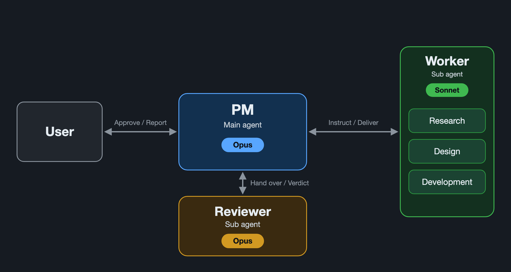

⬅️ [戻る](/blog/ja/index.md)

# レビューをサブエージェントに戻し、作業担当はHaikuを試してSonnetのままにしました

[前回の記事](20261011-2.md)で、メインエージェントがOpusでPMとレビューを兼任し、調査・設計・開発はSonnetのサブエージェントに任せる形に変えたと書きました。その後、さらに運用を見直したので、まとめます。

先に結論を書くと、レビューはサブエージェントに任せることにしました。また、調査・設計・開発をHaikuで代替できないか試しましたが、作業担当はSonnetのままにしています。

今のプラットフォームの流れは、次の図のとおりです。

## レビューをサブエージェントに任せることにした理由

メインがPMとレビューを兼任する形には、2つの問題がありました。

- **レビュー工程のコンテキストで、メインのコンテキストが増えていく。** 成果物を読んで確かめるたびに、メインが抱える情報が増えていきました。
- **独立した視点でレビューできない。** メインは経緯をすべて知っているので、どうしても先入観が入ります。

そこで、レビュー工程をサブエージェントに任せることにしました。メインのコンテキストを増やさずに済み、経緯を知らない第三者の視点で見てもらえます。

## 調査・設計・開発はHaikuで代替できないか

作業担当をSonnetからHaikuに替えられないか、気になって試してみました。

既存プロジェクトのコピーを使い、小・中・大の3つのタスクで実際に動かして比べています。

| 観点 | 結果 |
| --- | --- |
| スピード | ほぼ互角。小さいタスクではSonnetのほうが速かった |
| トークン | 使った量は同じくらい。単価の差で、費用はHaikuが約1/20 |
| 精度 | Sonnetが上。Haikuは事実と違う報告をした。そのうち1件はレビューでも見落とされた |

費用はHaikuが約1/20ですが、私はProプランなので、費用面はそれほど気になりません。スピードとトークンの使用量も変わらないので、Haikuに替えて得られるものは、あまりありませんでした。

## 結論: 作業担当はSonnetのまま

決め手は、報告が事実どおりであるかどうかでした。

PMは、成果の中身を見直さず、作業担当からの報告を頼りに流れを回します。そのため、報告が事実と違うと、そのまま次の工程に進んでしまいます。今回、Haikuの事実と違う報告のうち1件は、レビューでも見落とされました。

費用を気にしないなら、得られるものが少ないのに、報告の正確さを落とすリスクだけが残ります。そう考えて、作業担当はSonnetのままにしました。

## まとめ

- メインがPMとレビューを兼任すると、コンテキストが増え、独立した視点も持てないので、レビューはサブエージェントに任せることにしました
- 作業担当をHaikuにできないか、小・中・大の3タスクで比べました
- スピードはほぼ互角、トークンは同じくらいで、費用はHaikuが約1/20でした
- 精度はSonnetが上で、Haikuは事実と違う報告をし、1件はレビューでも見落とされました
- Proプランで費用は気にならず、PMは報告を頼りに流れを回すので、報告が事実どおりであることを重く見て、作業担当はSonnetのままにしました

費用を下げても、報告が信頼できなければ意味がありません。今の自分の環境では、Sonnetのままが一番安心でした。
