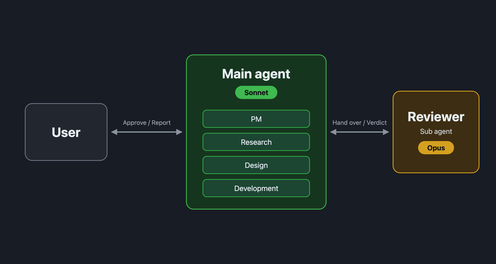

⬅️ [戻る](/blog/ja/index.md)

# メインをSonnetにして、レビューだけOpusに任せる形に切り替えました

## 結果

「Sonnetのメイン(PMと調査・設計・開発を兼任) + Opusのレビュー担当」という形に切り替えました。

現行の形(OpusのPM + Sonnetの作業担当 + Opusのレビュー担当)と比べて、精度はほとんど変わらず、時間とトークンの消費が大きく減ったからです。

| | 現行 | 案(切り替えた形) | 差 |
| --- | --- | --- | --- |
| 小: 時間 | 35分 | 17分 | -53% |
| 小: トークン | 771万 | 440万 | -43% |
| 小: 費用の目安 | 12.1ドル | 5.4ドル | -56% |
| 小: 精度(50点満点) | 49 | 47 | -2 |
| 中: 時間 | 55分 | 18分 | -67% |
| 中: トークン | 1188万 | 401万 | -66% |
| 中: 費用の目安 | 15.0ドル | 5.1ドル | -66% |
| 中: 精度(50点満点) | 42 | 47 | +5 |

時間・トークン・費用は、どちらの課題でも案が大きく下回りました。精度は、小では現行が2点上、中では案が5点上で、一方的な差ではありません。

切り替えたあとのプラットフォームの流れは、次の図のとおりです。

## 速く安くなった理由

現行では、Opusの出力が約10.6万〜12.3万トークンありました。案では、レビュー担当の分だけで約4.8万〜5.7万トークンです。

現行で多かった分は、主にOpusのPMが、作業担当とレビュー担当のあいだで成果の全文を中継し、書き直していた分でした。レビューの往復の回数は、どちらも同じくらい(レビュー担当への指示が6〜8回)だったので、差は中継のむだから来ています。

ほかにも、現行のPMが、裏で動いているサブエージェントの様子を14回も確かめに行っていました。

## 精度の差の中身

精度の差は、フローの形ではなく、そのときの作業担当の選び方から来ていました。

- **小(案が2点下):** 案は `lower()` を使ったため、大文字小文字を区別しない指定で「STRASSE」を検索したとき、「straße」の行を取りこぼしました。現行は `casefold()` を使い、両方を見つけました。
- **中(案が5点上):** 現行は正規表現として置換していて、空文字を渡すとテスト用の6ファイルがすべて壊れました。試したときのファイルも残していました。案は文字列のまま置換し、空文字のときは何もしませんでした。

精度は同じくらいとみるのが妥当だと思います。

## 比べ方

手元のプロジェクトのコピーを使い、小・中の2つの課題を、両方の形で1回ずつ、計4回動かしました。4回とも `claude -p` で、本物のメインエージェントとして実行しています。精度は50点満点で採点し、採点者にはどちらの形の成果かを伏せました。

## 注意点

- 各課題1回ずつなので、ばらつきは残っています。差が大きいので切り替えて様子を見ることにしました。
- 4回を同時に動かしたところ、約9分で利用上限に達し、そこから再開(resume)させました。再開のときにキャッシュを作り直す分が、両方の形に上乗せされています。上の数字はそれを含んだものです。
- 費用は、`claude -p` が出すAPI料金の目安です。

## 経緯

[前回の記事](20261017-1.md)までで、メインがOpusでPMを担当し、調査・設計・開発はSonnetのサブエージェント、レビューはOpusのサブエージェントという形に落ち着いたと書きました。その後、「メインをSonnetにして、調査・設計・開発も自分でやらせ、レビューだけOpusに任せたらどうなるか」が気になって試したのが、今回の比較です。

以前、メインをOpusにした似た案を試したときは、現行の約1.6〜2.1倍の費用がかかり、見送りました。今回はメインをSonnetにした点だけが違います。メインがOpusだと逆の結果になり、Sonnetにすると大きく改善したのは、自分でも意外でした。「どのモデルがどの役割を担うか」の組み合わせで、結果が大きく変わるようです。
