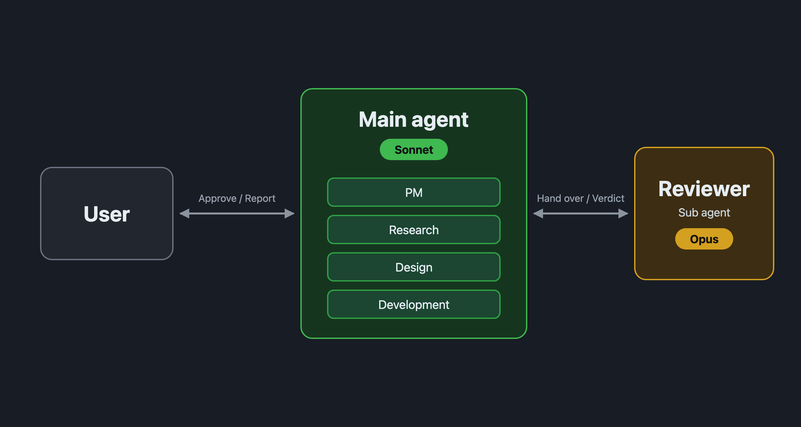

⬅️ [뒤로](/blog/ko/index.md)

# 메인을 Sonnet으로 하고, 리뷰만 Opus에게 맡기는 방식으로 바꿨습니다

## 결과

"Sonnet 메인(PM과 조사·설계·개발을 겸함) + Opus 리뷰 담당"이라는 방식으로 바꿨습니다.

지금까지의 방식(Opus PM + Sonnet 작업 담당 + Opus 리뷰 담당)과 비교해, 정확도는 거의 달라지지 않았고, 시간과 토큰 소비가 크게 줄었기 때문입니다.

| | 기존 | 안(바꾼 방식) | 차이 |
| --- | --- | --- | --- |
| 소: 시간 | 35분 | 17분 | -53% |
| 소: 토큰 | 771만 | 440만 | -43% |
| 소: 예상 비용 | 12.1달러 | 5.4달러 | -56% |
| 소: 정확도(50점 만점) | 49 | 47 | -2 |
| 중: 시간 | 55분 | 18분 | -67% |
| 중: 토큰 | 1188만 | 401만 | -66% |
| 중: 예상 비용 | 15.0달러 | 5.1달러 | -66% |
| 중: 정확도(50점 만점) | 42 | 47 | +5 |

시간·토큰·비용은 두 과제 모두에서 안이 크게 밑돌았습니다. 정확도는 소에서는 기존이 2점 위, 중에서는 안이 5점 위로, 어느 한쪽이 일방적으로 앞선 것은 아닙니다.

바꾼 뒤 플랫폼의 흐름은 다음 그림과 같습니다.

## 빠르고 저렴해진 이유

기존 방식에서는 Opus의 출력이 약 10.6만~12.3만 토큰이었습니다. 안에서는 리뷰 담당의 몫만으로 약 4.8만~5.7만 토큰입니다.

기존 방식에서 많았던 부분은, 주로 Opus PM이 작업 담당과 리뷰 담당 사이에서 결과물의 전문을 중계하고 다시 쓰던 부분이었습니다. 리뷰를 주고받은 횟수는 양쪽 모두 비슷했기 때문에(리뷰 담당에게 지시한 횟수가 6~8회), 차이는 중계의 낭비에서 온 것입니다.

그 밖에도 기존의 PM은 뒤에서 돌고 있는 서브 에이전트의 상태를 14번이나 확인하러 갔습니다.

## 정확도 차이의 내용

정확도 차이는 흐름의 형태가 아니라, 그때 작업 담당이 어떤 방법을 골랐는지에서 왔습니다.

- **소(안이 2점 아래):** 안은 `lower()`를 사용했기 때문에, 대소문자를 구분하지 않는 설정으로 "STRASSE"를 검색했을 때 "straße"가 있는 줄을 놓쳤습니다. 기존은 `casefold()`를 사용해 둘 다 찾았습니다.
- **중(안이 5점 위):** 기존은 정규 표현식으로 치환하고 있어서, 빈 문자열을 넘기면 테스트용 파일 6개가 모두 망가졌습니다. 시험할 때 만든 파일도 남겨 두었습니다. 안은 문자열 그대로 치환했고, 빈 문자열일 때는 아무것도 하지 않았습니다.

정확도는 비슷하다고 보는 것이 타당하다고 생각합니다.

## 비교 방법

로컬 프로젝트의 복사본을 사용해, 소·중 두 가지 과제를 양쪽 방식으로 한 번씩, 총 4번 돌렸습니다. 4번 모두 `claude -p`로, 실제 메인 에이전트로서 실행했습니다. 정확도는 50점 만점으로 채점했고, 채점자에게는 어느 방식의 결과물인지 알리지 않았습니다.

## 주의할 점

- 각 과제를 한 번씩만 돌렸기 때문에, 편차는 남아 있습니다. 차이가 커서 일단 바꾸고 상황을 지켜보기로 했습니다.
- 4번을 동시에 돌렸더니 약 9분 만에 사용 한도에 도달해, 거기서부터 재개(resume)시켰습니다. 재개할 때 캐시를 다시 만드는 분량이 양쪽 방식에 더해져 있습니다. 위의 수치는 그것을 포함한 것입니다.
- 비용은 `claude -p`가 출력하는 API 요금의 추정치입니다.

## 경위

[지난 글](20261017-1.md)까지, 메인이 Opus로 PM을 맡고, 조사·설계·개발은 Sonnet 서브 에이전트, 리뷰는 Opus 서브 에이전트가 하는 방식으로 정착했다고 썼습니다. 그 뒤로 "메인을 Sonnet으로 하고, 조사·설계·개발도 직접 하게 하고, 리뷰만 Opus에게 맡기면 어떻게 될까"가 궁금해져서 시험한 것이 이번 비교입니다.

예전에 메인을 Opus로 한 비슷한 안을 시험했을 때는, 기존의 약 1.6~2.1배의 비용이 들어서 보류했습니다. 이번에는 메인을 Sonnet으로 한 점만 다릅니다. 메인이 Opus일 때는 반대의 결과가 나왔고, Sonnet으로 하자 크게 개선된 것은 저도 의외였습니다. "어느 모델이 어떤 역할을 맡는가"의 조합에 따라 결과가 크게 달라지는 것 같습니다.
